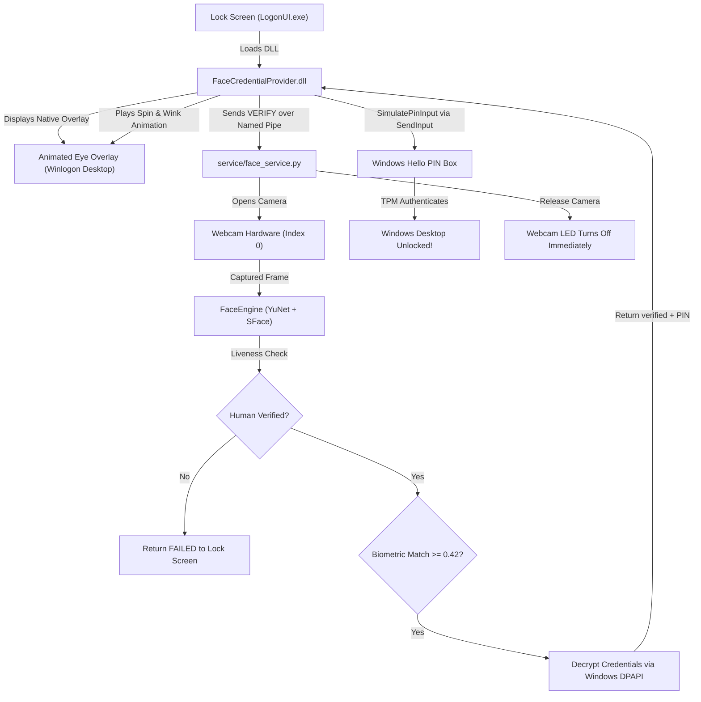

# Windows Hello Refined (Face ID on Any Camera)

[-0078D6?logo=windows)](https://microsoft.com)
[](https://python.org)
[-5C3EE8?logo=opencv)](https://opencv.org)
[](#security--privacy)

**Windows Hello Refined** brings native, sub-second biometric Face Unlock to **any standard RGB laptop or USB webcam**—no specialized infrared (IR) or depth camera hardware required.

It integrates directly into the genuine **Windows Lock Screen (`LogonUI.exe`)** using a native 64-bit C++ Windows Credential Provider, displaying the official-style animated gazing eye ("Looking for you...") that spins into a smile upon verification and unlocks straight to the desktop.

---

## Built With

The project combines low-level Windows operating system internals with modern deep learning and computer vision:

### Core Technologies & Frameworks
| Layer | Technologies Used | Description |
| :--- | :--- | :--- |
| **Biometric AI & Vision** | **OpenCV DNN**, **YuNet (2023mar)**, **SFace (2021dec)** | Lightweight CNNs for ultra-fast face detection (~15ms) and 128-dimensional feature embedding extraction (~35ms). |
| **Anti-Spoofing & Liveness** | **Laplacian Texture Variance**, **YCrCb Chromaticity** | Filters out mobile screens, printed photos, and digital displays by detecting moiré patterns and unnatural specular reflections. |
| **Lock Screen Integration** | **C++17**, **Windows Credential Provider SDK** (`ICredentialProviderCredential3`) | Native 64-bit DLL loaded directly by `LogonUI.exe` on the secure `Winlogon` desktop. |
| **Visual Animation & HUD** | **Win32 Layered Windows**, **GDI+**, `BITMAPV5HEADER` | Transparent overlay rendered with per-pixel alpha compositing, featuring gazing eye tracking, 900° spin, wink, and drop shadows. |
| **Biometric & Credential Vault**| **Windows DPAPI** (`CryptProtectData` / `CryptUnprotectData`) | Hardware-backed cryptographic protection tied directly to the current user's Windows security descriptor. |
| **Inter-Process Communication** | **Win32 Named Pipes** (`\\.\pipe\WindowsHelloRefinedPipe`) | Secure, high-throughput IPC between the lock screen credential provider and the pre-warmed background vision daemon. |
| **Automated Unlock Engine** | **Win32 `SendInput`** (`KEYEVENTF_UNICODE`) | Types the DPAPI-secured Windows Hello PIN directly into the active logon desktop for instant TPM-verified unlock on Windows 11. |
| **Tooling & Compilers** | **MSVC x64** (`cl.exe`, `link.exe`), **Python 3.10+ Virtual Environment** | Visual Studio 2022/2026 C++ toolchain and Windows SDK (`user32`, `gdiplus`, `credui`, `secur32`, `wtsapi32`). |

---

## Key Features

- **Standard RGB Camera Support**: Works on 720p/1080p laptop webcams and USB cameras without infrared.
- **Native Lock Screen Animation**: Official Windows Hello-style animated gazing eye appears at the top center of the lock screen from the very beginning.
- **Instant Unlock (~1.1s)**: Fast multi-stage verification pipeline with zero cold-start camera delay.
- **Windows 11 Passwordless Compliant**: Supports Microsoft Accounts (`DevicePasswordLessBuildVersion = 2`) via hardware-backed PIN simulation.
- **PIN Fallback Always Intact**: Windows Hello PIN remains fully accessible in "Sign-in options" at all times.
- **Anti-Spoofing & Liveness Verification**: Rejects smartphones, photo prints, and static images.
- **Hardware-Friendly**: Camera hardware is released immediately upon verification (webcam LED turns off instantly).
- **Walk-Away Auto-Lock (Optional)**: Automatically locks your workstation (<kbd>Win</kbd> + <kbd>L</kbd>) when you step away from your desk.

---

## Prerequisites

- **Operating System**: Windows 10 (64-bit) or Windows 11 (64-bit).
- **Camera**: Standard built-in webcam or external USB webcam (Index `0`).
- **Python**: Python 3.10, 3.11, 3.12, or 3.13 (64-bit) installed and added to `PATH`.
- **Compiler (Optional, only if compiling DLL from source)**: Visual Studio 2022 or 2026 with "Desktop development with C++" installed. *(A precompiled 64-bit DLL is included.)*

---

## Setup & Installation Guide

### Step 1: Clone the Repository
```powershell
git clone https://github.com/aryandas079/Windows-Hello-Refined.git
cd "Windows Hello Refined"
```

### Step 2: Set Up Python Virtual Environment
Create and activate a virtual environment, then install required packages:
```powershell
python -m venv .venv
.\.venv\Scripts\Activate.ps1
pip install -r requirements.txt
```

### Step 3: Enroll Your Face Profile
Run the one-time interactive face enrollment tool:
```powershell
.\.venv\Scripts\python.exe setup_face.py
```
- A camera window will open with an on-screen HUD.
- Follow the 4-step prompts:
  1. **Look Straight** (5 samples)
  2. **Turn Slightly Left** (3 samples)
  3. **Turn Slightly Right** (3 samples)
  4. **Tilt / Smile Naturally** (3 samples)
- Biometric embeddings are encrypted with **Windows DPAPI** and stored in `data/face_profile.enc`.

### Step 4: Save Windows Hello PIN (For Instant Auto-Unlock)
On Windows 11 with a Microsoft Account, Windows disables password authentication on the lock screen and only accepts your Windows Hello PIN.

Run the PIN configuration utility:
```powershell
.\.venv\Scripts\python.exe save_pin.py
```
- Enter your **Windows Hello PIN** (e.g. your 4-digit or 6-digit numeric PIN).
- The PIN is encrypted with **Windows DPAPI** and stored in `data/credentials.enc`.

> [!NOTE]
> Your PIN never leaves your computer; it is protected by the Windows Data Protection API and can only be decrypted on your specific machine by your user account.

### Step 5: (Optional) Build Credential Provider DLL from Source
If you wish to recompile the native 64-bit C++ Credential Provider:
```cmd
cmd /c "credential_provider\build.bat"
```
*(Uses the Developer Command Prompt toolchain to produce `credential_provider\FaceCredentialProvider.dll`.)*

### Step 6: Register with Windows Lock Screen
Open PowerShell or Command Prompt **as Administrator** and register the DLL:
```powershell
regsvr32 "D:\Projects_New\Windows Hello Refined\credential_provider\FaceCredentialProvider.dll"
```
You will receive a confirmation dialog: `DllRegisterServer in ...FaceCredentialProvider.dll succeeded.`

*(To unregister at any time, run `regsvr32 /u "path\to\FaceCredentialProvider.dll"`.)*

---

## How to Use

### 1. Interactive CLI Manager
You can manage the entire application through the unified interactive manager:
```powershell
.\.venv\Scripts\python.exe manage.py
```
```
Options:
  1. Enroll Face Profile (Run this first!)
  2. Save Windows Hello PIN for Instant Auto-Unlock
  3. Live Camera & Face Recognition Test (Visual HUD)
  4. Start Background Face ID Daemon (Named Pipe Service)
  5. Start Walk-Away Auto-Lock (Presence Guard)
  6. Register Native Windows Lock Screen Credential Provider
  7. Unregister Credential Provider
  8. Preview Transparent Windows Hello HTML/SVG Animation
  0. Exit
```

---

### 2. Live Camera & Recognition Test
To test face recognition speed and anti-spoofing without locking your screen:
```powershell
.\.venv\Scripts\python.exe engine\test_live.py
```
- **Green Box**: Enrolled user recognized (shows similarity percentage, e.g. 78%).
- **Orange Box**: Unknown face.
- **Red Box**: Spoof attempt detected (photo print or phone screen).
- Press <kbd>q</kbd> or <kbd>Esc</kbd> to exit.

---

### 3. Start the Background Service
The background service handles webcam requests from the Windows lock screen:
```powershell
.\.venv\Scripts\python.exe service\face_service.py
```
You should see:
```
[SERVICE] Windows Hello Refined Face ID Service started.
[SERVICE] Listening on Named Pipe: \\.\pipe\WindowsHelloRefinedPipe
```

---

### 4. Lock Your PC & Unlock with Face ID
1. Press <kbd>Win</kbd> + <kbd>L</kbd> to lock your screen.
2. The animated gazing eye appears immediately at the top center: *"Windows Hello: Looking for you..."*.
3. Look at your webcam.
4. Within **~1.1 seconds**, your face is verified:
   - The scanning arc spins 900° into a smile and winks: *"Hello, <YourName>"*.
   - The system automatically enters your PIN and unlocks your PC to the desktop!
5. **Fallback**: If you are not in front of the camera, your Windows Hello PIN is right there in "Sign-in options" to enter manually.

---

## Automatic Startup on Windows Boot

To have the Face ID daemon run automatically in the background whenever you log in:

### Option A: Create a Windows Scheduled Task (Recommended)
Open PowerShell **as Administrator** and run:
```powershell
$action = New-ScheduledTaskAction -Execute "$PWD\.venv\Scripts\pythonw.exe" -Argument "service\face_service.py" -WorkingDirectory "$PWD"
$trigger = New-ScheduledTaskTrigger -AtLogOn
$settings = New-ScheduledTaskSettingsSet -AllowStartIfOnBatteries -DontStopIfGoingOnBatteries -ExecutionTimeLimit 0
Register-ScheduledTask -TaskName "WindowsHelloRefinedDaemon" -Action $action -Trigger $trigger -Settings $settings -RunLevel Highest
```
*(Using `pythonw.exe` runs the service completely silently in the background with no console window.)*

### Option B: Add to Startup Folder
Press <kbd>Win</kbd> + <kbd>R</kbd>, type `shell:startup`, and create a shortcut pointing to:
```
Target: "D:\Projects_New\Windows Hello Refined\.venv\Scripts\pythonw.exe" "D:\Projects_New\Windows Hello Refined\service\face_service.py"
Start in: "D:\Projects_New\Windows Hello Refined"
```

---

## Security & Privacy Architecture



1. **Zero Cloud Dependencies**: 100% of detection, alignment, feature extraction, and matching runs entirely offline on your local machine.
2. **DPAPI Hardware Binding**: Profiles are encrypted using Windows Data Protection API (`win32crypt.CryptProtectData`). Only your logged-in Windows security principal can decrypt them.
3. **Hardware Privacy Indicator**: The camera is opened strictly for 1-2 seconds during verification and released immediately (`cv2.VideoCapture.release()`), ensuring the physical camera LED remains off while your PC is in use.

---

## Directory Structure

```
Windows Hello Refined/
├── assets/                  # High-DPI icons & vector HUD assets
│   ├── hello_normal.png     # Official Windows Hello face icon
│   └── hello_wink.png       # Happy winking face icon
├── credential_provider/     # Native 64-bit C++ Windows Credential Provider
│   ├── build.bat            # MSVC compiler script
│   ├── FaceCredential.cpp   # Credential tile logic & PIN auto-unlock simulation
│   ├── FaceCredential.h     # ICredentialProviderCredential3 interface definitions
│   ├── FaceCredentialProvider.cpp # Tile enumeration & LogonUI registration
│   ├── FaceOverlay.cpp      # Top-center animated layered window overlay
│   ├── FaceOverlay.h        # Overlay state machine & GDI+ renderer
│   └── FaceCredentialProvider.dll # Compiled binary
├── engine/                  # Biometric detection & verification engine
│   ├── face_engine.py       # YuNet detector + SFace recognizer + Liveness filters
│   ├── storage.py           # DPAPI profile & PIN encryption handlers
│   └── test_live.py         # Real-time visual verification HUD
├── enrollment/              # Biometric enrollment tools
│   └── enroll.py            # Head-pose enrollment script
├── models/                  # Pretrained ONNX deep learning models
│   ├── face_detection_yunet_2023mar.onnx
│   └── face_recognition_sface_2021dec.onnx
├── service/                 # Background system services
│   ├── face_service.py      # Named pipe IPC biometric daemon
│   └── session_guard.py     # Walk-away auto-lock presence monitor
├── manage.py                # Unified interactive CLI manager
├── save_pin.py              # DPAPI Windows Hello PIN storage tool
├── setup_face.py            # Graphical 4-angle enrollment application
└── requirements.txt         # Python package dependencies
```

---

## Diagnostic Logging & Troubleshooting

### Real-Time Logs
Windows Credential Provider actions are logged directly to:
```
C:\Users\Public\WindowsHelloRefined.log
```
To view live logs in PowerShell:
```powershell
Get-Content -Path "C:\Users\Public\WindowsHelloRefined.log" -Wait -Tail 30
```

### Frequently Asked Questions

**Q: Why doesn't it unlock with my Outlook / Microsoft account password?**  
**A:** Windows 11 enforces `DevicePasswordLessBuildVersion = 2` for Microsoft Accounts, which disables password unlocks at the lock screen for security. Windows strictly requires your **Windows Hello PIN** (verified by the TPM chip). Run `.\.venv\Scripts\python.exe save_pin.py` to store your PIN.

**Q: The camera doesn't turn on or fails to verify.**  
**A:** Check if another application (such as Zoom, Teams, or Skype) has locked the webcam. Also ensure that `CAMERA_INDEX` in `engine/face_engine.py` matches your camera (default is `0`).

**Q: How do I completely uninstall the lock screen provider?**  
**A:** Open an Administrator PowerShell and run:
```powershell
regsvr32 /u "D:\Projects_New\Windows Hello Refined\credential_provider\FaceCredentialProvider.dll"
```
Windows will instantly restore default sign-in options without a reboot.

---

## License
This project is open-source under the MIT License.
