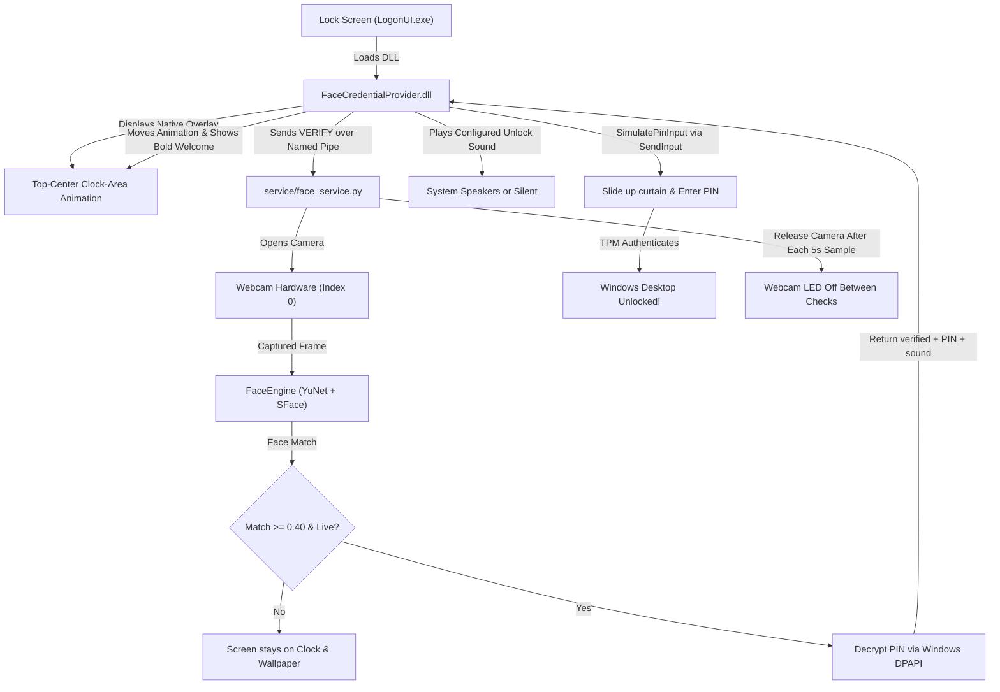

# Windows Hello Refined (Face ID on Any Camera)

[-0078D6?logo=windows)](https://microsoft.com)
[](https://python.org)
[-5C3EE8?logo=opencv)](https://opencv.org)
[](#security--privacy)
[](LICENSE)

**Windows Hello Refined** brings native, sub-second biometric Face Unlock to **any standard RGB laptop or USB webcam** without requiring specialized infrared (IR) or depth camera hardware.

Created by **Aryan Das**  
- GitHub: [@aryandas079](https://github.com/aryandas079) (https://github.com/aryandas079)  
- LinkedIn: [@iam-aryandas](https://linkedin.com/in/iam-aryandas) (https://linkedin.com/in/iam-aryandas)  

It integrates directly into the genuine **Windows Lock Screen (`LogonUI.exe`)** using a native 64-bit C++ Windows Credential Provider. During verification, a minimalist official-style animated eye appears in the top-center clock area directly below the webcam. If low lighting is detected, a bold low lighting indicator informs the user. After verification it displays a bold Segoe UI welcome message, plays the selected unlock feedback sound, fills the Windows Hello PIN, and unlocks.

---

## Built With

The project combines low-level Windows operating system internals with modern deep learning and computer vision:

### Core Technologies and Frameworks
| Layer | Technologies Used | Description |
| :--- | :--- | :--- |
| **Biometric AI and Vision** | **OpenCV DNN**, **YuNet (2023mar)**, **SFace (2021dec)** | Lightweight CNNs for ultra-fast face detection (~15ms) and 128-dimensional feature embedding extraction (~35ms). |
| **Liveness and Diagnostics** | **Laplacian Texture Variance**, **YCrCb Chromaticity**, **MediaPipe 478 Mesh** | Evaluates 3D depth volume, surface curvature, optical Moiré patterns, and pure cheek skin texture to reject 2D screen and photo spoofs. |
| **Lock Screen Integration** | **C++17**, **Windows Credential Provider SDK** (`ICredentialProviderCredential3`) | Native 64-bit DLL loaded directly by `LogonUI.exe` on the secure `Winlogon` desktop. |
| **Visual Animation and HUD** | **Win32 Layered Windows**, **GDI+**, `BITMAPV5HEADER` | Transparent overlay in the lock-screen clock area, featuring gaze tracking, a 900-degree spin, wink, bold Segoe UI welcome text, and drop shadows. |
| **Audio Feedback Engine** | **Win32 WaveOut**, **Direct Audio Routing**, `sound_config.py` | Plays selectable feedback chimes (Windows Hello chime, Windows Unlock, Chimes, Ding, Tada, or custom WAV) through system speakers with a silent option. |
| **Biometric and Credential Vault**| **Windows DPAPI** (`CryptProtectData` / `CryptUnprotectData`) | Hardware-backed cryptographic protection tied directly to the current user's Windows security descriptor. |
| **Inter-Process Communication** | **Win32 Named Pipes** (`\\.\pipe\WindowsHelloRefinedPipe`) | Secure, high-throughput IPC between the lock screen credential provider and the background vision daemon. |
| **Automated Unlock Engine** | **Win32 `SendInput`** (`KEYEVENTF_UNICODE`) | Types the DPAPI-secured Windows Hello PIN directly into the active logon desktop for instant TPM-verified unlock on Windows 11. |
| **Presence & User Activity** | **Win32 `GetLastInputInfo`**, **DirectShow camera polling** | Automatically locks the workstation on prolonged face absence while preventing premature lockouts during active typing and mouse movement. |
| **Tooling and Compilers** | **MSVC x64** (`cl.exe`, `link.exe`), **Python 3.10+ Virtual Environment** | Visual Studio 2022/2026 C++ toolchain and Windows SDK (`user32`, `gdiplus`, `credui`, `secur32`, `wtsapi32`, `winmm`). |

---

## Key Features

- **One-Click Installation and Removal**: Single `install.bat` sets up everything; single `uninstall.bat` cleanly removes everything.
- **Standard RGB Camera Support**: Works on 720p/1080p laptop webcams and USB cameras without infrared.
- **Minimalist Native Lock Screen Animation**: Clean animated eye overlay appears directly below the webcam in the top-center clock area without cluttering text.
- **Low Light Indicator**: Displays a bold "Low lighting detected" subtitle below the eye animation when ambient illumination is insufficient.
- **Selectable Unlock Sound**: Choose between the default Windows Hello chime, Windows Unlock, Windows Notify, classic chimes, custom WAV files, or silent mode.
- **Verified Welcome Feedback**: After a match, displays a clearly visible bold Segoe UI "Welcome, <username>" message before PIN entry.
- **Wallpaper and Clock Maintained**: The transparent overlay preserves the selected wallpaper and clock. Automatic cleanup removes promotional content and widgets while keeping Spotlight wallpaper rotation and "Like what you see?" controls.
- **Ultra-Fast Camera Detection (<0.5s)**: Optimized DirectShow camera pipeline and lock-screen pre-warming unlock genuine users in less than 0.5 seconds (typically ~250ms - 380ms).
- **12,500+ Dense 3D Depth Point Cloud Projection**: Projects over 12,500 continuous 3D depth points and wireframe Delaunay mesh lines across the facial manifold to compute 3D surface curvature, normal vector azimuth dispersion, and planarity ratio.
- **Precision Anti-Spoofing vs. Phones, Photos, and Videos**: Multi-layer biometric defenses eliminate spoof attacks from mobile phone screens, tablets, printed photos, and replay videos via:
  - Phone chassis border and screen bezel edge detection
  - LCD/OLED subpixel frequency and optical Moiré pattern analysis (2D FFT)
  - Pure skin Laplacian micro-texture frequency verification
  - Glass mirror specular reflection detection
  - Biological hemoglobin subsurface scattering (melanin/Hb spectral absorption)
  - True 3D depth volume planarity verification (rejects flat 2D presentations)
- **Hardware-Friendly**: Presence monitoring samples every 5 seconds and releases the camera between samples so the webcam LED turns off.
- **Activity-Aware Walk-Away Auto-Lock**: Locks the workstation after the configured absence timeout. Active typing or mouse input resets the timer so the PC never locks prematurely while in use.
- **Auto-Starts on Boot and Restart**: Automatically active when turning on your PC from shutdown or after rebooting.

---

## Quick Start: One-Click Installation

The entire setup is unified into a single script:

### 1. Download or Clone the Repository
```powershell
git clone https://github.com/aryandas079/Windows-Hello-Refined.git
cd "Windows Hello Refined"
```

### 2. Run the All-in-One Installer
Double-click `install.bat` (or run in an elevated command prompt):
```cmd
install.bat
```

The installer automatically guides you through the full onboarding:
1. **Administrator Elevation**: Prompts for UAC elevation if not already running as admin.
2. **Environment Setup**: Verifies Python 3.10+ and automatically sets up `.venv` with `requirements.txt`.
3. **Face Biometric Enrollment**: Opens the camera HUD and captures 14 multi-angle samples (Look straight, Turn left, Turn right, Tilt/Smile).
4. **Windows Hello PIN Setup**: Asks for your Windows Hello PIN once and encrypts it locally with Windows DPAPI.
5. **Clean Lock Screen**: Automatically declutters lock-screen news cards, widgets, tips, and promotional overlays while preserving wallpaper rotation and feedback controls.
6. **Auto-Lock Timeout Configuration**: Prompts you to pick your preferred absence auto-lock duration (30s, 1m, 2m, 5m, 10m, 30m, 1hr, or Never).
7. **Unlock Sound Preference**: Allows selecting an unlock feedback chime (with audio previews) or choosing silent mode.
8. **Credential Provider Registration**: Registers `FaceCredentialProvider.dll` with Windows LogonUI (`regsvr32`).
9. **Boot-Time Startup Service**: Registers a Windows Scheduled Task (`WindowsHelloRefinedDaemon`) to automatically run on computer startup, restart, and login.
10. **Service Startup**: Launches the background daemon immediately so you are ready to use it without rebooting.

### 3. Test It
Press <kbd>Win</kbd> + <kbd>L</kbd> to lock your screen. Look at your camera to verify and unlock.

---

## Complete Removal: One-Click Uninstaller

To completely remove Windows Hello Refined from your device:

Double-click `uninstall.bat` (or run in an elevated command prompt):
```cmd
uninstall.bat
```

The uninstaller automatically:
1. Terminates any running background face service.
2. Deletes the Windows boot-time Scheduled Task and registry startup keys.
3. Unregisters `FaceCredentialProvider.dll` from Windows LogonUI (`regsvr32 /u`).
4. Cleans up all Credential Provider registry entries from `HKLM`.
5. Prompts whether you want to delete your saved biometric data and encrypted PIN.
6. Restores Windows native sign-in state completely intact.

---

## Interactive Management Console

For manual testing, individual component diagnostics, or fine-tuning, run the interactive manager:

```powershell
.\.venv\Scripts\python.exe manage.py
```

```
Options:
  1. Enroll Face Profile (Run this first!)
  2. Save Windows Hello PIN for Instant Auto-Unlock
  3. Live Camera & Face Recognition Test (Visual HUD)
  4. Start Background Face ID Daemon (Named Pipe Service)
  5. Start Walk-Away Auto-Lock (Presence Guard)
  6. Register Native Windows Lock Screen Credential Provider
  7. Unregister Credential Provider
  8. Run All-in-One Installer (install.bat)
  9. Run All-in-One Uninstaller (uninstall.bat)
 10. Clean Lock Screen (Remove News, Fun Facts, Tips & Widgets)
 11. Preview Transparent Windows Hello HTML/SVG Animation
 12. Set Face-Absence Auto-Lock Timeout
  0. Exit
```

---

## Security & Privacy Architecture



1. **Zero Cloud Dependencies**: 100% of detection, alignment, feature extraction, and matching runs entirely offline on your local machine.
2. **DPAPI Hardware Binding**: Profiles and PINs are encrypted using Windows Data Protection API (`win32crypt.CryptProtectData`). Only your logged-in Windows security principal can decrypt them.
3. **Hardware Privacy Indicator**: During presence monitoring, the camera is opened for each 5-second sample and released immediately (`cv2.VideoCapture.release()`), so the physical camera LED is off between checks. Lock-screen verification opens it only while verification is active.
4. **Input-Gated Auto-Lock**: Hardware input signals (`GetLastInputInfo`) verify whether the keyboard or mouse was used recently, ensuring you are not locked out while looking down or reading.

---

## Contributing

Contributions are welcome. We are actively seeking input from the computer vision and security community to further harden RGB anti-spoofing against high-res phone screen replays.

- Check out the open issue: **[Strengthen Anti-Spoofing Against Phone Screens](https://github.com/aryandas079/Windows-Hello-Refined/issues)**
- Feel free to submit an issue or open a Pull Request with improvements to `engine/face_engine.py`.

---

## Directory Structure

```
Windows Hello Refined/
├── assets/                  # High-DPI icons & audio assets
│   ├── hello_normal.png     # Official Windows Hello face icon
│   ├── hello_wink.png       # Happy winking face icon
│   └── hello_verified.wav   # Default soft chime feedback sound
├── credential_provider/     # Native 64-bit C++ Windows Credential Provider
│   ├── build.bat            # MSVC compiler script
│   ├── FaceCredential.cpp   # Credential tile logic & PIN auto-unlock simulation
│   ├── FaceCredential.h     # ICredentialProviderCredential3 interface definitions
│   ├── FaceCredentialProvider.cpp # Ambient overlay registration (0 sign-in tiles)
│   ├── FaceOverlay.cpp      # Clock-area animation and verified welcome overlay
│   ├── FaceOverlay.h        # Overlay state machine & GDI+ renderer
│   └── FaceCredentialProvider.dll # Compiled 64-bit binary
├── engine/                  # Biometric detection & verification engine
│   ├── face_engine.py       # YuNet detector + SFace recognizer + Liveness filters
│   ├── storage.py           # DPAPI profile & PIN encryption handlers
│   └── test_live.py         # Real-time visual verification HUD
├── models/                  # Pretrained ONNX deep learning models
│   ├── face_detection_yunet_2023mar.onnx
│   └── face_recognition_sface_2021dec.onnx
├── service/                 # Background system services
│   ├── face_service.py      # Named pipe IPC daemon and configurable presence auto-lock
│   ├── presence_service.py  # Interactive-user 5-second camera pulse watcher
│   ├── presence_config.py   # Auto-lock presets and persisted timeout
│   ├── sound_config.py      # Unlock feedback sound selector & preview engine
│   └── session_guard.py     # Walk-away auto-lock presence monitor
├── clean_lockscreen.py      # De-clutter utility that preserves wallpaper assets
├── install.bat              # Single All-in-One installer (Setup + PIN + Clean + Register + Auto-Start)
├── manage.py                # Unified interactive CLI manager
├── README.md                # Documentation
├── requirements.txt         # Python package dependencies
├── save_password.py         # Password storage utility
├── save_pin.py              # DPAPI Windows Hello PIN storage tool
├── setup_face.py            # Graphical 4-angle enrollment application
└── uninstall.bat            # Single All-in-One uninstaller
```

---

## Diagnostic Logging & Troubleshooting

### Real-Time Logs
Windows Credential Provider actions are logged directly to:
```
C:\Users\Public\WindowsHelloRefined.log
```
To view live logs in PowerShell:
```powershell
Get-Content -Path "C:\Users\Public\WindowsHelloRefined.log" -Wait -Tail 30
```

---

## Author

**Aryan Das**
- GitHub: [@aryandas079](https://github.com/aryandas079) (https://github.com/aryandas079)
- LinkedIn: [@iam-aryandas](https://linkedin.com/in/iam-aryandas) (https://linkedin.com/in/iam-aryandas)

---

## License

This project is licensed under the Apache License, Version 2.0. See the [LICENSE](LICENSE) file for the full license text.
