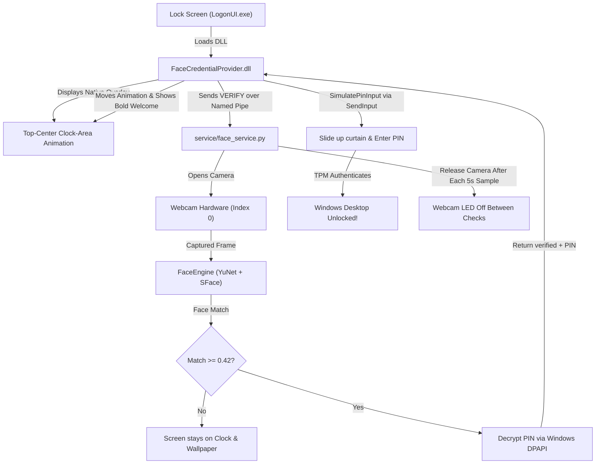

# Windows Hello Refined (Face ID on Any Camera)

[-0078D6?logo=windows)](https://microsoft.com)
[](https://python.org)
[-5C3EE8?logo=opencv)](https://opencv.org)
[](#security--privacy)
[](LICENSE)

**Windows Hello Refined** brings native, sub-second biometric Face Unlock to **any standard RGB laptop or USB webcam** without requiring specialized infrared (IR) or depth camera hardware.

Created by **Aryan Das**  
- GitHub: [@aryandas079](https://github.com/aryandas079) (https://github.com/aryandas079)  
- LinkedIn: [@iam-aryandas](https://linkedin.com/in/iam-aryandas) (https://linkedin.com/in/iam-aryandas)  

It integrates directly into the genuine **Windows Lock Screen (`LogonUI.exe`)** using a native 64-bit C++ Windows Credential Provider. Before verification, the complete official-style animation appears in the top-center home area directly below the webcam, where the lock-screen clock is shown. After verification it displays a bold Segoe UI welcome message, fills the Windows Hello PIN, and unlocks.

---

## Built With

The project combines low-level Windows operating system internals with modern deep learning and computer vision:

### Core Technologies and Frameworks
| Layer | Technologies Used | Description |
| :--- | :--- | :--- |
| **Biometric AI and Vision** | **OpenCV DNN**, **YuNet (2023mar)**, **SFace (2021dec)** | Lightweight CNNs for ultra-fast face detection (~15ms) and 128-dimensional feature embedding extraction (~35ms). |
| **Liveness and Diagnostics** | **Laplacian Texture Variance**, **YCrCb Chromaticity**, landmarks, depth | Provides diagnostic signals for screens, prints, and static-image spoofing analysis. |
| **Lock Screen Integration** | **C++17**, **Windows Credential Provider SDK** (`ICredentialProviderCredential3`) | Native 64-bit DLL loaded directly by `LogonUI.exe` on the secure `Winlogon` desktop. |
| **Visual Animation and HUD** | **Win32 Layered Windows**, **GDI+**, `BITMAPV5HEADER` | Transparent overlay in the lock-screen clock area, featuring gaze tracking, a 900-degree spin, wink, bold Segoe UI welcome text, and drop shadows. |
| **Biometric and Credential Vault**| **Windows DPAPI** (`CryptProtectData` / `CryptUnprotectData`) | Hardware-backed cryptographic protection tied directly to the current user's Windows security descriptor. |
| **Inter-Process Communication** | **Win32 Named Pipes** (`\\.\pipe\WindowsHelloRefinedPipe`) | Secure, high-throughput IPC between the lock screen credential provider and the background vision daemon. |
| **Automated Unlock Engine** | **Win32 `SendInput`** (`KEYEVENTF_UNICODE`) | Types the DPAPI-secured Windows Hello PIN directly into the active logon desktop for instant TPM-verified unlock on Windows 11. |
| **Tooling and Compilers** | **MSVC x64** (`cl.exe`, `link.exe`), **Python 3.10+ Virtual Environment** | Visual Studio 2022/2026 C++ toolchain and Windows SDK (`user32`, `gdiplus`, `credui`, `secur32`, `wtsapi32`). |

---

## Key Features

- **One-Click Installation and Removal**: Single `install.bat` sets up everything; single `uninstall.bat` cleanly removes everything.
- **Standard RGB Camera Support**: Works on 720p/1080p laptop webcams and USB cameras without infrared.
- **Native Lock Screen Animation**: The complete “Looking for you...” animation appears in the top-center clock/home area, directly below the webcam, before the PIN section is shown.
- **Verified Welcome Feedback**: After a match, the animation moves toward the PIN area and shows a clearly visible bold Segoe UI “Welcome, <username>” message before PIN entry.
- **Wallpaper and Clock Maintained**: The transparent overlay does not replace the lock-screen wallpaper or clock. Cleanup disables promotional content while preserving the selected wallpaper and its cache.
- **Fast Unlock**: Face matching returns as soon as a valid match is found, then the saved PIN is entered and submitted automatically.
- **Windows 11 Passwordless Compliant**: Supports Microsoft Accounts (`DevicePasswordLessBuildVersion = 2`) via hardware-backed PIN simulation.
- **Hidden from Sign-in Tiles**: Operates as an ambient background overlay without creating clutter or duplicate tiles under Sign-in options.
- **Liveness Diagnostics**: Includes texture, color, landmark, and depth checks for diagnostics; the current fast unlock decision uses the configured face-match path.
- **Hardware-Friendly**: Presence monitoring samples every 5 seconds and releases the camera between samples so the webcam LED turns off.
- **Auto-Starts on Boot and Restart**: Automatically active when turning on your PC from shutdown or after rebooting.
- **Lock Screen De-Cluttering**: Option during setup to disable Spotlight news, fun facts, tips, feeds, and widgets without deleting the active wallpaper cache.
- **Walk-Away Auto-Lock**: While Windows is unlocked, the daemon samples the camera every 5 seconds and locks the workstation after the configured absence timeout.

---

## Quick Start: One-Click Installation

The entire setup is unified into a single script:

### 1. Download or Clone the Repository
```powershell
git clone https://github.com/aryandas079/Windows-Hello-Refined.git
cd "Windows Hello Refined"
```

### 2. Run the All-in-One Installer
Double-click `install.bat` (or run in an elevated command prompt):
```cmd
install.bat
```

The installer automatically guides you through the full onboarding:
1. **Administrator Elevation**: Prompts for UAC elevation if not already running as admin.
2. **Environment Setup**: Verifies Python 3.10+ and automatically sets up `.venv` with `requirements.txt`.
3. **Face Biometric Enrollment**: Opens the camera HUD and captures 14 multi-angle samples (Look straight, Turn left, Turn right, Tilt/Smile).
4. **Windows Hello PIN Setup**: Asks for your Windows Hello PIN once and encrypts it locally with Windows DPAPI.
5. **Clean Lock Screen**: Asks whether to remove Windows Spotlight fun facts, “Like what you see?”/“Not for me” prompts, news, tips, feeds, detailed status apps, and MSN widgets while preserving the wallpaper, clock, and wallpaper cache.
6. **Credential Provider Registration**: Registers `FaceCredentialProvider.dll` with Windows LogonUI (`regsvr32`).
7. **Boot-Time Startup Service**: Registers a Windows Scheduled Task (`WindowsHelloRefinedDaemon`) to automatically run on computer startup, restart, and login.
8. **Service Startup**: Launches the background daemon immediately so you are ready to use it without rebooting.

### 3. Test It
Press <kbd>Win</kbd> + <kbd>L</kbd> to lock your screen. Look at your camera to verify and unlock!

If you choose **Y** for lock-screen cleanup during installation, Windows keeps the current wallpaper and clock,
preserves the wallpaper cache, and removes promotional suggestions, Spotlight trivia, feeds, widgets, and detailed status content.
The saved PIN remains available internally so face verification can unlock automatically.

---

## Complete Removal: One-Click Uninstaller

To completely remove Windows Hello Refined from your device:

Double-click `uninstall.bat` (or run in an elevated command prompt):
```cmd
uninstall.bat
```

The uninstaller automatically:
1. Terminates any running background face service.
2. Deletes the Windows boot-time Scheduled Task and registry startup keys.
3. Unregisters `FaceCredentialProvider.dll` from Windows LogonUI (`regsvr32 /u`).
4. Cleans up all Credential Provider registry entries from `HKLM`.
5. Prompts whether you want to delete your saved biometric data and encrypted PIN.
6. Restores Windows native sign-in state completely intact.

---

## Interactive Management Console

For manual testing, individual component diagnostics, or fine-tuning, run the interactive manager:

```powershell
.\.venv\Scripts\python.exe manage.py
```

```
Options:
  1. Enroll Face Profile (Run this first!)
  2. Save Windows Hello PIN for Instant Auto-Unlock
  3. Live Camera & Face Recognition Test (Visual HUD)
  4. Start Background Face ID Daemon (Named Pipe Service)
  5. Start Walk-Away Auto-Lock (Presence Guard)
  6. Register Native Windows Lock Screen Credential Provider
  7. Unregister Credential Provider
  8. Run All-in-One Installer (install.bat)
  9. Run All-in-One Uninstaller (uninstall.bat)
 10. Clean Lock Screen (Remove News, Fun Facts, Tips & Widgets)
 11. Preview Transparent Windows Hello HTML/SVG Animation
  12. Set Face-Absence Auto-Lock Timeout
  0. Exit
```

---

## Security & Privacy Architecture



1. **Zero Cloud Dependencies**: 100% of detection, alignment, feature extraction, and matching runs entirely offline on your local machine.
2. **DPAPI Hardware Binding**: Profiles and PINs are encrypted using Windows Data Protection API (`win32crypt.CryptProtectData`). Only your logged-in Windows security principal can decrypt them.
3. **Hardware Privacy Indicator**: During presence monitoring, the camera is opened for each 5-second sample and released immediately (`cv2.VideoCapture.release()`), so the physical camera LED is off between checks. Lock-screen verification opens it only while verification is active.

---

## Directory Structure

```
Windows Hello Refined/
├── assets/                  # High-DPI icons & vector HUD assets
│   ├── hello_normal.png     # Official Windows Hello face icon
│   └── hello_wink.png       # Happy winking face icon
├── credential_provider/     # Native 64-bit C++ Windows Credential Provider
│   ├── build.bat            # MSVC compiler script
│   ├── FaceCredential.cpp   # Credential tile logic & PIN auto-unlock simulation
│   ├── FaceCredential.h     # ICredentialProviderCredential3 interface definitions
│   ├── FaceCredentialProvider.cpp # Ambient overlay registration (0 sign-in tiles)
│   ├── FaceOverlay.cpp      # Clock-area animation and verified welcome overlay
│   ├── FaceOverlay.h        # Overlay state machine & GDI+ renderer
│   └── FaceCredentialProvider.dll # Compiled 64-bit binary
├── engine/                  # Biometric detection & verification engine
│   ├── face_engine.py       # YuNet detector + SFace recognizer + Liveness filters
│   ├── storage.py           # DPAPI profile & PIN encryption handlers
│   └── test_live.py         # Real-time visual verification HUD
├── models/                  # Pretrained ONNX deep learning models
│   ├── face_detection_yunet_2023mar.onnx
│   └── face_recognition_sface_2021dec.onnx
├── service/                 # Background system services
│   ├── face_service.py      # Named pipe IPC daemon and configurable presence auto-lock
│   ├── presence_service.py  # Interactive-user 5-second camera pulse watcher
│   ├── presence_config.py   # Auto-lock presets and persisted timeout
│   └── session_guard.py     # Walk-away auto-lock presence monitor
├── clean_lockscreen.py      # De-clutter utility that preserves wallpaper assets
├── install.bat              # Single All-in-One installer (Setup + PIN + Clean + Register + Auto-Start)
├── manage.py                # Unified interactive CLI manager
├── README.md                # Documentation
├── requirements.txt         # Python package dependencies
├── save_password.py         # Password storage utility
├── save_pin.py              # DPAPI Windows Hello PIN storage tool
├── setup_face.py            # Graphical 4-angle enrollment application
└── uninstall.bat            # Single All-in-One uninstaller
```

---

## Diagnostic Logging & Troubleshooting

### Real-Time Logs
Windows Credential Provider actions are logged directly to:
```
C:\Users\Public\WindowsHelloRefined.log
```
To view live logs in PowerShell:
```powershell
Get-Content -Path "C:\Users\Public\WindowsHelloRefined.log" -Wait -Tail 30
```

---

## Author

**Aryan Das**
- GitHub: [@aryandas079](https://github.com/aryandas079) (https://github.com/aryandas079)
- LinkedIn: [@iam-aryandas](https://linkedin.com/in/iam-aryandas) (https://linkedin.com/in/iam-aryandas)

---

## License

This project is licensed under the Apache License, Version 2.0. See the [LICENSE](file:///d:/Projects_New/Windows%20Hello%20Refined/LICENSE) file for the full license text.
